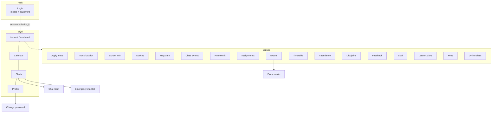
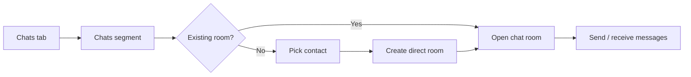

# Eklavya — Information Architecture

**Product:** Eklavya (parent mobile app)  
**Platform:** Gurukull (`https://app.gurukull.in`)  
**Audience:** School parents with one or more linked students  
**Client:** React Native + Ant Design Mobile (`Eklavya-ant`)  
**Official icon:** [`assets/eklavya-icon.png`](assets/eklavya-icon.png) — tree with **G** on navy (Play / launcher brand mark)

---

## 1. Navigation model

Eklavya uses a **shell** with:

| Layer | Role |
|--------|------|
| **Auth gate** | Login (mobile + password) before any school data |
| **Top bar** | Menu (drawer), screen title, optional child/avatar context |
| **Bottom tabs** | Four primary destinations always reachable |
| **Drawer** | Secondary modules grouped by purpose |
| **Nested screens** | Push-style detail (chat room, exam marks, change password) |

Session and selected child are stored on-device (AsyncStorage). API traffic goes to `https://app.gurukull.in/api`.

---

## 2. Bottom tabs

| Tab | Screen key | Purpose |
|-----|------------|---------|
| **Home** | `dashboard` | Overview, notices preview, **child switcher**, shortcuts into modules |
| **Calendar** | `events` | School calendar / events |
| **Chats** | `messages` | Staff chat + **Emergency** school mail (broadcast alerts) |
| **Profile** | `profile` | Parent profile, child summary, theme, password, logout |

---

## 3. Drawer menu (secondary)

Drawer lists destinations that are **not** bottom-tab roots. Nested-only screens are omitted from the drawer.

### Profile group
- Apply leave (`leave`)
- Track location (`trackLocation`) — school transport trip status from server (not device GPS)

### School group
- School info (`school`)
- Notice board (`notices`)
- Magazine (`magazine`)

### Classes group
- Class events (`classEvents`)
- Homework (`homework`)
- Assignments (`assignments`)
- Exams (`exams`) → nested **Exam marks** (`examMarks`)
- Timetable (`timetable`)
- Attendance (`attendance`)
- Discipline (`discipline`)

### Others group
- Feedback (`feedback`)
- Staff info (`staff`)
- Lesson plan (`lessonPlans`)
- Fees (`fees`)
- Online class (`onlineClass`) — scheduled online-class list / stub where no sessions exist

**Nested (not in drawer):**
- Change password (`changePassword`) — from Profile
- Chat room (`chatRoom`) — from Chats
- Exam marks (`examMarks`) — from Exams

---

## 4. Screen map



---

## 5. Sitemap-style hierarchy

```text
Eklavya
├── Login
└── App shell
    ├── Home (tab)
    │   ├── Child switcher
    │   └── Module shortcuts → drawer screens
    ├── Calendar (tab)
    ├── Chats (tab)
    │   ├── Chats segment → Chat room (nested)
    │   └── Emergency segment → broadcast / school mail (read)
    ├── Profile (tab)
    │   ├── Theme (light / dark / system)
    │   ├── Change password (nested)
    │   └── Logout
    └── Drawer
        ├── Apply leave
        ├── Track location
        ├── School info
        ├── Notice board
        ├── Magazine
        ├── Class events
        ├── Homework
        ├── Assignments
        ├── Exams → Exam marks
        ├── Timetable
        ├── Attendance
        ├── Discipline
        ├── Feedback
        ├── Staff info
        ├── Lesson plan
        ├── Fees
        └── Online class
```

---

## 6. Primary user flows

### 6.1 Login → Home → module

```mermaid
sequenceDiagram
  actor Parent
  participant App as Eklavya
  participant API as app.gurukull.in

  Parent->>App: Enter registered mobile + password
  App->>API: POST /parent/login (+ device_id)
  alt Already logged in on another device
    API-->>App: Error (another device)
    Parent->>App: Confirm logout other devices
    App->>API: POST /logout/devices
    App->>API: Retry login
  end
  API-->>App: Token + parent profile
  App->>App: Persist session; ensure selected child
  App-->>Parent: Home dashboard
  Parent->>App: Open drawer / shortcut / tab
  App->>API: Authenticated module request (Bearer)
  App-->>Parent: Module screen for selected child
```

**Notes**
- Login field is **mobile number**, not email (as registered in Gurukull).
- Single-device policy: app sends a locally generated `device_id`; conflicting sessions can be cleared via logout-all-devices.
- Most academic modules are scoped to the **currently selected child**.

### 6.2 Child switcher

1. Parent opens Home (or uses child context where shown).  
2. Sees linked children count and current child.  
3. Picks another student → selection saved locally.  
4. Subsequent API calls use the new `student_id`.

### 6.3 Chat with school staff / admin



1. Open **Chats** tab → **Chats** segment.  
2. Open an existing room, or start a new chat from contacts (staff/admin).  
3. App creates a direct chat room if needed → **Chat room** nested screen.  
4. Messages sync via Gurukull API (school-side moderation/policies apply).

### 6.4 Apply leave

1. Drawer → **Apply leave**.  
2. Choose from/to dates, leave reason, optional remarks.  
3. Submit → school workflow (approval visible when school processes it).  
4. Parent can review past leave applications; pending items may be cancellable per API rules.

### 6.5 Emergency school mail

1. Open **Chats** tab → **Emergency** segment.  
2. View broadcast / emergency notices from school admin.  
3. These are **not** a two-way chat — read school alerts/mail list.

### 6.6 Fees, homework, exams (typical module pattern)

1. Ensure correct child is selected.  
2. Open module from drawer (or Home shortcut).  
3. Pull-to-refresh loads latest records from Gurukull.  
4. Drill into detail where available (e.g. exam → exam marks).

### 6.7 Track location / online class

- **Track location:** Shows transport trip status and location list returned by the school platform when a trip is active. Does **not** request the parent phone’s GPS permission in the current React Native build.  
- **Online class:** Lists scheduled online classes when the school publishes them; otherwise empty state.

---

## 7. Cross-cutting concerns

| Concern | Behaviour |
|---------|-----------|
| Auth | Bearer token; expired/revoked token forces return to Login |
| Child scope | Most student data requires a selected child |
| Theme | Light / dark / follow device (saved on device) |
| Connectivity | Requires internet; all school data is server-backed |
| Media | Relative upload paths resolved against `https://app.gurukull.in` |

---

## 8. IA checklist for Play Store / support copy

Use these names consistently in listing, FAQ, and website:

- Eklavya / Gurukull Parent App  
- Home, Calendar, Chats, Profile  
- Child switcher  
- Attendance, Homework, Assignments, Exams & marks, Timetable, Fees  
- Apply leave, Notices, Feedback  
- Chat with staff, Emergency school mail  
- Track location (transport), Online class  
- Dark / light theme

